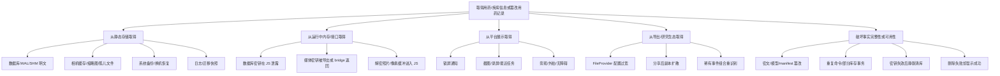

# 长期用药管理 APP｜威胁模型与安全验证

> 本文将离线 MVP 的安全决策转换为攻击面、控制和可复现验证。它不构成渗透测试完成证明，也不作任何地区的法律合规声明。离线 MVP 是产品范围与医疗边界的最高基线。

## 0. 安全结论

当前架构可以进入使用合成数据的 Phase 0 技术验证，但在 S01、S02、S03、S05、S07 通过且由人类安全负责人签署前，不得进入真实患者研究。

设备丢失是本模型的首要现实场景之一：未解锁设备主要依靠系统加密、SQLCipher、媒体加密和中性通知降低暴露；已解锁或已被攻击者取得设备凭据时，应用锁与及时重锁只提供附加防线，不应被表述为绝对保护。

最关键的安全不变量是：

1. **媒体主密钥永不进入 JavaScript 内存。** 它只以不可导出密钥存在于 Android Keystore，并只被原生 `Cipher` 操作引用；JavaScript 不得取得原文、可序列化包装或可调用的通用密钥导出接口。
2. **媒体明文的暴露面最小。** 相机缓存明文必须在加密落盘后立即删除；不生成明文缩略图，不经 JS/Base64 传递照片或可逆像素缓冲。
3. **数据库、WAL/SHM、媒体、密钥、导出暂存和日志均不进入系统备份。**
4. **研究导出是一次明确的数据披露。** 只有字段白名单、预览和逐次授权后才生成；系统分享后的副本不能由 App 召回。
5. **任何密钥、模型、通知或相机故障不得诱发明文降级、静默清库、伪造成功或错误服药事实。**

## 1. 范围、假设和安全目标

### 1.1 范围内组件

- Expo/React Native/TypeScript release-like Android 应用。
- SQLCipher SQLite、WAL/SHM、migration 临时快照。
- Expo SecureStore 中的数据库密钥。
- Android Keystore 中的媒体主密钥、本地 Expo 媒体加密模块、加密照片/缩略图。
- 相机缓存、受控解密展示、TFLite/LiteRT 推理适配器。
- 本地通知、应用锁、截屏/录屏与最近任务保护。
- 本地诊断、研究事件、研究导出暂存与 FileProvider 分享。
- 删除、卸载、密钥失效、低存储、强杀和系统备份/迁移行为。

### 1.2 不在范围内

- 物理芯片实验室攻击、Android/TEE/StrongBox 供应商零日漏洞。
- 已 root 且攻击者完全控制内核后的绝对保密保证。
- 用户主动拍摄屏幕、主动复制分享文件或把设备交给他人解锁使用。
- P1 应用级加密备份、iOS、服务器、账号、在线模型和远程医疗服务。

这些不在范围内的项目不是“没有风险”，而是需要在参与者告知、设备纳入条件、研究运营或未来独立威胁模型中处理。

### 1.3 安全目标

| 目标 | 要求 |
| --- | --- |
| 保密性 | 未经授权者不能从文件、日志、备份、屏幕或分享接口读取处方、照片、用药事实和密钥 |
| 完整性 | 密文篡改被拒绝；确认、库存、撤销和审计不可出现部分提交或伪造关联 |
| 可用性 | 模型、相机、通知可安全降级；密钥/数据库不可用时不创建明文库或静默清空 |
| 最小权限 | 只申请相机、通知和必要平台能力；不申请相册、联系人、位置或后台网络能力 |
| 可追溯 | 高风险设置、导出、删除、修订和密钥错误有脱敏本地事件，不泄露敏感内容 |
| 隐私控制 | 用户能理解并控制应用锁、截屏、照片保留、研究导出和清除 |

## 2. 资产、攻击者与信任边界

### 2.1 资产分级

| 资产 | 敏感性 | 完整性要求 | 可用性要求 |
| --- | --- | --- | --- |
| 处方、药名、疾病线索、症状文本 | 极高 | 高 | 中 |
| 日常照片、处方原图、外观基准 | 极高 | 高（GCM 认证） | 中；可删除且无 P0 恢复 |
| 逐药确认、库存、漏服/副作用记录 | 极高 | 极高；影响历史和库存 | 高 |
| 数据库密钥 | 关键秘密 | 极高 | 高；丢失即不可恢复 |
| 媒体主密钥和每文件数据密钥 | 关键秘密 | 极高 | 高；丢失即媒体不可恢复 |
| 研究事件和研究导出 | 高 | 高；字段范围和包完整性可核验 | 中 |
| 模型、阈值、manifest 和安全文案 | 中/高 | 高；篡改可能误导用户 | 中；失败可关闭视觉 |
| 通知意图和 opaque ID | 中 | 高；不得串任务 | 中；提醒尽力而为 |
| 本地审计/诊断 | 中 | 高 | 低；可限额、可清除 |

### 2.2 攻击者模型

| 代号 | 能力 | 目标 |
| --- | --- | --- |
| A1 旁观者/持机者 | 看到锁屏、最近任务、短时拿到已解锁设备 | 获取药名、疾病、服药行为 |
| A2 普通恶意 App | 读取通知、尝试截图/录屏/覆盖层/剪贴板、接收分享 URI | 获取屏幕、通知、导出或误导点击 |
| A3 本地调试/备份攻击者 | 取得 APK、应用文件/备份、logcat 或调试接口 | 离线读取数据库、媒体、密钥和日志 |
| A4 被攻陷依赖/应用进程 | 能在 App 进程执行代码或调用 JS/native 接口 | 读取解密数据、调用 Keystore、修改事实/导出 |
| A5 Root/系统级攻击者 | 读写沙箱、抓内存、注入进程或替换系统组件 | 盗取明文、调用密钥、绕过 UI 保护 |
| A6 恶意/错误研究接收方 | 获得合法研究包并与招募数据连接 | 重识别、超目的使用、长期保留 |

防护目标主要覆盖 A1–A3，并降低 A4 的攻击面。对 A5 不承诺完全防护；可检测 root/调试状态并作为研究设备纳入风险信号，但不得把 root 检测当作唯一安全控制。A6 主要依赖最小化、研究治理、权限分离和销毁 SOP。

### 2.3 攻击树



## 3. 冻结的密钥与加密架构

### 3.1 密钥层级

```text
Android Keystore
  MK_media: AES-256, non-exportable, alias + version only visible to JS
      └─ wraps DEK_photo_i (native memory only, best-effort zeroized)
            └─ AES-256-GCM encrypts photo_i / thumbnail_i with unique 96-bit nonce

Expo SecureStore
  K_db: random 256-bit SQLCipher key
      └─ returned briefly to the database-open boundary; never logged/persisted elsewhere

P1 backup key
  Not implemented; must be independent from K_db and MK_media.
```

数据库密钥和媒体密钥不得复用。媒体主密钥不允许通过 SecureStore 存储原文；SecureStore 只可保存其 alias、版本和非敏感能力信息。硬件安全级别由 `KeyInfo` 记录并进入设备兼容证据；TEE/StrongBox 可提升隔离，但软件 Keystore 与硬件 Keystore 都必须保持 API 不可导出。

### 3.2 强制原生接口契约

```ts
type MediaAssetId = string;
type NativeMediaErrorCode =
  | 'KEY_UNAVAILABLE'
  | 'AUTH_REQUIRED'
  | 'STORAGE_FULL'
  | 'AUTHENTICATION_FAILED'
  | 'INTEGRITY_FAILED'
  | 'PLAINTEXT_CLEANUP_FAILED';

interface MediaCryptoPort {
  initializeKey(aliasVersion: number): Promise<{
    alias: string;
    securityLevel: 'software' | 'trusted_environment' | 'strongbox' | 'unknown';
  }>;
  encryptCameraFile(inputContentUri: string, assetId: MediaAssetId): Promise<{
    assetId: MediaAssetId;
    cipherSizeBytes: number;
    formatVersion: number;
  }>;
  verifyCiphertext(assetId: MediaAssetId): Promise<{ valid: boolean }>;
  deleteAsset(assetId: MediaAssetId): Promise<{ deleted: boolean }>;
}
```

禁止在公开 JS 接口出现：`exportKey`、`getRawKey`、`unwrapDataKey`、`decryptToBase64`、`decryptToBytes`、明文路径返回、任意路径读写、任意 alias 选择或通用加密 oracle。敏感显示和推理必须使用专用原生组件/方法，只接受数据库授权后的 `assetId`，内部校验路径位于固定私有根目录，并仅返回最小结果。

### 3.3 AES-GCM 文件格式最低要求

| 字段 | 要求 |
| --- | --- |
| 魔数/格式版本 | 固定长度，必须被认证；未知版本拒绝 |
| asset ID/用途 | 作为 AAD 或认证头的一部分，防止文件替换/用途混淆 |
| wrapped DEK | 由 `MK_media` 认证封装；不得可逆编码明文保存 |
| content nonce | 每文件/每次加密唯一的 96-bit nonce，由安全随机源生成 |
| tag | 使用完整认证 tag；认证失败不输出任何明文 |
| 密文长度 | 解密前设置上限，防止内存/存储耗尽 |
| 原子协议 | 临时密文 → fsync → 验证 → 原子改名 → 删除明文 |

禁止 nonce 重用、硬编码 key、ECB/CBC 无认证、截短 tag、认证后置明文输出和“解密失败时尝试明文打开”。

## 4. 威胁登记与控制

### 4.1 静态存储、缓存和备份

| ID | 威胁/路径 | 影响 | 控制 | 验证 | 残余 |
| --- | --- | --- | --- | --- | --- |
| T-ST-01 | 普通 SQLite、WAL/SHM 或 migration 快照泄露明文 | 极高 | SQLCipher、先 key 后 schema、快照同等保护且及时清理 | 原始字节哨兵、错钥匙、强杀、WAL 检查 | 被攻陷进程仍可读取已打开库 |
| T-ST-02 | 相机缓存明文、明文缩略图、孤儿临时文件 | 极高 | 原生流式加密、无明文缩略图、启动清理、失败不 prepared | 每阶段强杀后递归扫描；低存储测试 | 短时明文仍存在于相机缓存 |
| T-ST-03 | 可预测文件名或错误 FileProvider 路径暴露药物信息 | 高 | 随机 ID、私有根、provider exported=false、路径白名单 | manifest/XML 审查、路径穿越 fuzz | Root 可绕过沙箱 |
| T-ST-04 | Auto Backup/D2D 恢复数据库、密钥或照片 | 极高 | allowBackup=false、双版本排除、SecureStore 排除 | Android 11-/12+ 备份恢复哨兵 | OEM 违规行为需设备矩阵记录 |
| T-ST-05 | 日志、异常栈、崩溃文件含药名/路径/key | 极高 | release 禁 logcat 详情、固定错误码、脱敏本地环形日志 | 静态扫描、故障注入后日志正则扫描 | 原生第三方库可能输出不可控日志 |
| T-ST-06 | APK 中硬编码 key/端点/真实测试数据 | 极高 | 构建 secret 扫描、合成 fixture、SBOM | APK strings/assets/DEX 扫描 | 混淆不能替代无秘密设计 |

### 4.2 密钥、进程与恶意应用

| ID | 威胁/路径 | 影响 | 控制 | 验证 | 残余 |
| --- | --- | --- | --- | --- | --- |
| T-KY-01 | 媒体主密钥从 Keystore/bridge 导出 | 极高 | non-exportable key、`getEncoded()==null`、窄接口、无 key serialization | 代码审查、Frida/bridge 调用清单、堆/日志扫描 | A4/A5 可在本机请求合法解密 |
| T-KY-02 | 数据库密钥在 JS 全局、Redux/Zustand、错误对象或 source map 暴露 | 极高 | 启动局部读取、禁止状态持久化、redacted wrapper、release 禁调试 | Hermes heap/日志/错误注入检查 | JS 无可靠显式擦除 |
| T-KY-03 | 生物识别变化/卸载导致 key 失效后生成新 key 覆盖旧数据 | 高 | KEY_UNAVAILABLE 恢复页、不建明文/新库、不静默清空 | 增删生物识别、卸载/重装、认证取消 | P0 无备份意味着真实数据可能永久丢失 |
| T-KY-04 | GCM nonce 重用或 tag/header 篡改 | 极高 | 安全随机、每次唯一、认证 header/AAD、失败关闭 | 大样本 nonce 唯一、NIST 向量、篡改矩阵 | 随机源/实现错误仍需审计 |
| T-KY-05 | 通用原生解密 oracle 被其他 JS/恶意模块滥用 | 极高 | assetId 授权、专用展示/推理端口、调用上下文和路径限制 | 越权 assetId、任意路径、alias fuzz | 进程完全攻陷时难阻止授权上下文伪造 |
| T-KY-06 | 调试包/开发菜单/远程 Metro 进入研究分发 | 极高 | release-like 签名包、debuggable=false、内嵌 bundle、受控分发 | APK manifest、无 Metro、调试连接测试 | 构建供应链和签名账户风险 |

### 4.3 屏幕、通知和本地交互

| ID | 威胁/路径 | 影响 | 控制 | 验证 | 残余 |
| --- | --- | --- | --- | --- | --- |
| T-UI-01 | 锁屏通知泄露药名/结果 | 高 | 固定中性文案、opaque ID、无锁屏详细模式 | 通知 payload/监听器/历史检查 | 提醒时间可推断规律 |
| T-UI-02 | 截图、录屏、投屏、最近任务捕获敏感页 | 高 | FLAG_SECURE、后台遮挡、路由同步保护 | 四类捕获、切路由/旋转泄露帧 | 外拍、OEM/系统漏洞无法阻止 |
| T-UI-03 | 旁观者取得已解锁 App | 高 | 可选应用锁、后台/锁屏重锁、设备凭据 | 超时、取消、旋转、强杀恢复 | 用户拒绝应用锁时风险较高 |
| T-UI-04 | 恶意覆盖层/无障碍服务诱导确认或读屏 | 极高 | 高风险确认二次核对、敏感窗口安全提示、研究设备筛查 | overlay/tapjacking、启用无障碍场景 | Android 合法无障碍能力无法全面封锁 |
| T-UI-05 | 剪贴板、键盘学习或自动填充保存自由文本 | 高 | 不提供敏感复制、禁 autofill/个性化学习、输入提示 | 主流键盘/剪贴板真机测试 | 第三方输入法仍可能收集输入 |
| T-UI-06 | 通知深链重放导致重复扣库存 | 极高 | 只传 opaque ID、完成后只读、幂等命令 | 重复点击/旧通知/伪造 ID | 被攻陷 DB 可改写映射，需完整性审计 |

### 4.4 研究导出、删除和生命周期

| ID | 威胁/路径 | 影响 | 控制 | 验证 | 残余 |
| --- | --- | --- | --- | --- | --- |
| T-EX-01 | 未授权或后台生成研究包 | 极高 | 有效同意、字段预览、用户手势、审计、无后台任务 | 无同意/过期同意/取消/并发测试 | 恶意进程可绕过 UI，仍受字段白名单限制 |
| T-EX-02 | 整库/照片/自由文本混入导出 | 极高 | schema 白名单、拒绝未知字段、独立 DTO、golden package | 属性测试、敏感哨兵扫描、包解压审查 | 新字段加入时需重新签署 manifest |
| T-EX-03 | FileProvider 过宽、写权限或永久 URI grant | 极高 | 专用导出目录、exported=false、只读短期 URI、分享后撤销 | provider fuzz、授权列表、路径穿越 | 接收 App 打开后可复制 |
| T-EX-04 | 多次包可链接或与招募表重识别 | 高 | 一次性包 ID、时间分桶、稀有类别抑制、身份映射分离 | 唯一性/连接/成员推断测试 | 小样本纵向研究仍可能高风险 |
| T-EX-05 | 导出暂存或取消分享后残留 | 高 | 私有 cache、完成/取消/启动清理、备份排除 | 强杀/低存储/取消后文件扫描 | 分享目标已有副本不受控制 |
| T-EX-06 | 照片删除失败却留墓碑成功态 | 高 | 两事务 pending→验证→tombstone；失败重试 | 权限/占用/强杀/只读文件测试 | 文件系统物理残留不可法证级保证 |
| T-EX-07 | 全部清除遗漏 DB/WAL、key、日志或导出 | 极高 | 清除清单、先封锁写入/销毁 key、路径验证 | 清除前后清单、错钥匙、冷启动 | 系统/OEM/已分享副本可能仍存在 |
| T-EX-08 | 卸载/设备损坏造成不可用并被误认为备份存在 | 高 | 首次说明无 P0 恢复、P1 公开前硬门禁 | 可用性理解测试、卸载演练 | 内部研究仍可能丢失记录 |

### 4.5 供应链、模型和事实完整性

| ID | 威胁/路径 | 影响 | 控制 | 验证 | 残余 |
| --- | --- | --- | --- | --- | --- |
| T-SC-01 | 依赖含网络遥测、恶意代码或已知高危漏洞 | 极高 | 精确锁版本/哈希、SBOM、最少依赖、release 无网络权限 | 依赖/许可/端点扫描、全程抓包 | 社区库维护和零日风险 |
| T-SC-02 | 运行时更新/远程配置绕过审核 | 极高 | updates.enabled=false、内嵌 bundle/model/content | APK 配置、首次启动离线、端点扫描 | 分发渠道仍需签名保护 |
| T-SC-03 | TFLite/manifest 被替换或输出 NaN/异常 | 高 | 安装包签名、manifest SHA-256、schema/有限值/超时校验 | 缺失/篡改/形状/NaN 测试 | 模型误报漏报由模型评测处理 |
| T-SC-04 | 模型结果驱动服药/库存事实 | 极高 | 端口和 schema 分离、repository 无该方法 | 静态调用图、契约/端到端测试 | 后续开发误接需持续守护测试 |
| T-SC-05 | 重复命令/崩溃产生部分确认或重复扣减 | 极高 | 独占事务、幂等键、事实/流水同事务 | kill point、重放、并发和 invariant 检查 | 数据库底层损坏仍需恢复策略 |
| T-SC-06 | 数据库/文件替换造成照片错关联 | 高 | asset ID/用途入 AAD、DB 外键、同任务关联校验 | 交换密文/header/DB link 测试 | Root 可同时篡改数据库和进程逻辑 |

## 5. 安全验证计划

### 5.1 Gate 与停止规则

- Gate B：S01、S02、S03、S05、S07 任一安全失败即不通过；不得以用户文案替代技术控制。
- 真实患者研究：除 Gate B 外，必须完成 PIA、威胁模型、依赖/SBOM、研究包重识别、设备矩阵、医学/隐私/伦理签署。
- 视觉：S06 可降级为完全关闭；不得改用联网模型或放宽媒体密钥/明文边界。
- 提醒：S04 可降级为近似提醒；不得承诺绝对送达。
- 密钥不可用、数据库不可写：允许阻断敏感记录写入，但禁止创建明文副本、静默清库或伪造成功。

### 5.2 静态验证

| 检查 | 技术 | 通过标准 |
| --- | --- | --- |
| Android manifest | 最终 APK/aapt 分析 | release-like `debuggable=false`；provider 不导出；无不必要权限；备份/更新配置正确 |
| 依赖/SBOM | lockfile、Gradle graph、native `.so`、许可证和漏洞扫描 | 全部依赖可追溯到版本/哈希；无未批准遥测/动态代码 |
| JS/native bridge | TypeScript spec、Expo Module exports、Kotlin code review | 无 key、DEK、Base64、明文字节/路径导出；仅固定根和 assetId |
| 秘密/敏感日志 | source/APK strings/日志调用扫描 | 无硬编码 key、真实患者 fixture、药名/路径/自由文本日志 |
| FileProvider | manifest、paths XML、URI grant | 只暴露导出临时子目录、只读、短期、exported=false |
| 网络面 | manifest、端点字符串、HTTP client/import | P0 无 HTTP repository；release 无外联或无 INTERNET 权限 |
| 模型边界 | repository/领域调用图 | VisionObservation 无路径可写 confirmation/inventory/lifecycle |

### 5.3 动态密钥和内存验证

1. 在 D-L、D-N、D-C 生成媒体主密钥，记录 alias 和 `KeyInfo.securityLevel`；`SecretKey.getEncoded()` 必须返回 `null`。
2. 枚举 JS 可调用原生方法及返回对象，搜索任何 key/DEK/明文照片字段；尝试参数注入、任意 alias、`../` 路径、其他 asset ID。
3. 在拍照、展示、推理和删除时捕获脱敏 Hermes heap、native heap 样本与 logcat；不得找到媒体主密钥、封装前 DEK、照片 Base64 或明文完整文件路径。
4. 数据库密钥仅允许在启动开库的短生命周期出现。故障、Promise rejection、React error boundary 和日志序列化不得泄露；记录 JS 不能可靠擦除的残余风险。
5. 增删生物识别、取消认证、设备锁变化、升级、卸载重装和全部清除；不得自动替换 key 或创建新明文库。
6. 被 root/动态插桩设备只用于证明防护边界，不以“检测到 root”直接证明安全；记录 Keystore key 在本机仍可能被授权进程调用的残余风险。

### 5.4 媒体与删除故障注入

在相机写缓存、原生读取、DEK 生成、加密中、fsync、改名、DB 事务前后、明文删除和缩略图处理各点强杀。每次重启检查：

- 成功记录恰有一个有效密文和数据库引用；失败记录不进入 `prepared`。
- 缓存、tmp、files、noBackup、导出目录和数据库引用之间没有明文或孤儿敏感文件。
- 交换 ciphertext/header/wrapped DEK/nonce/tag、截断、翻转位、追加垃圾和超大长度均在输出明文前拒绝。
- 30 张/设备无 nonce 重复只是 Spike 最小样本；实现还须用安全随机源和文件唯一性约束，不把抽样当数学保证。
- 删除失败保持 pending 且不能展示；成功后密文、缩略图、wrapped DEK、nonce/tag/路径不可用，只保留最小墓碑。

### 5.5 恶意应用与平台验证

- 安装测试通知监听器、截图/录屏、投屏、overlay、无障碍服务、第三方键盘和接收分享的恶意样例 App。
- 验证锁屏通知只有中性文案和 opaque ID，不能由 ID 直接推断药物/用户。
- 验证敏感页、路由切换、旋转和最近任务；使用另一台设备外拍作为证据并记录无法防止的物理旁观。
- 验证应用锁后台重锁、取消、设备凭据回退、进程恢复；认证失败不删除或展示数据。
- 验证剪贴板/自动填充/键盘候选不会由 App 主动提供敏感内容；第三方输入法收集属于告知和设备筛查残余风险。

### 5.6 备份、零网络和发布验证

- Android 11 及以下验证 `fullBackupContent`，Android 12+ 验证 `dataExtractionRules`；云备份和设备迁移均使用合成哨兵。
- 对 database、WAL/SHM、files/media、cache、SecureStore、研究、导出、诊断和 migration 临时区逐目录检查，恢复哨兵数必须为零。
- release-like APK 在首次启动、建档、拍照、展示、通知、推理、研究预览/导出和全部清除全程抓包；用户打开分享前 DNS/TCP/HTTP 必须为零。
- 校验 `updates.enabled=false`、内嵌 JS/model/content、APK 签名、`debuggable=false`、无开发菜单/Metro 和无真实患者 fixture。

### 5.7 研究包攻击测试

1. 无同意、同意过期/撤销、未预览、取消分享、并发导出和进程强杀均不得留下可分享包。
2. 对每个禁止字段放入独特哨兵；导出包、文件名、manifest、校验值和分享 intent 均不得出现。
3. schema 使用正向白名单；新增数据库列不会自动进入包，未知 manifest 字段拒绝。
4. FileProvider 测试读取其他私有路径、路径穿越、写权限、持久授权和分享结束后重新打开；全部拒绝。
5. 基于计划样本量测试唯一事件组合、精确时间连接、成员推断、多次包链接及与招募表连接；未达到研究/隐私负责人门槛时扩大时间桶、合并/抑制稀有类别或移除纵向 ID。
6. 明确记录：接收方成功读取后，App 删除临时包或撤销 URI 不能删除已复制副本；研究 SOP 是必要补充控制。

## 6. 安全验收用例

| 用例 | 预期 |
| --- | --- |
| 错误/缺失数据库密钥 | `KEY_UNAVAILABLE`，不建新库、不删除旧库、不输出 SQL/路径/key |
| 媒体 `getEncoded()` 与 JS bridge 枚举 | 主密钥不可导出；JS 无 key/DEK/plain bytes API |
| 任意 assetId、alias、路径穿越 | 原生模块拒绝，不能形成通用解密 oracle |
| 加密各阶段强杀 | 无明文/可解密缩略图孤儿；未持久照片不显示成功 |
| 篡改 header/nonce/tag/ciphertext/wrapped DEK | 100% 返回完整性失败，零明文输出 |
| 低存储/相机拒权/模型崩溃 | 可跳过或返回 `unable`；人工主链继续；不明文降级 |
| DB 事务强杀/重复点击/通知重放 | 全有或全无；无重复确认、库存和导出 |
| Android 11-/12+ 备份恢复 | 所有敏感哨兵恢复数为零 |
| release 飞行模式与抓包 | 核心流程可运行；分享前网络请求为零 |
| 截图/录屏/最近任务 | 敏感页默认阻断/空白；显式放开后才允许；外拍记录为残余风险 |
| 应用锁取消/生物识别变化 | 不展示敏感数据、不删数据；进入安全恢复说明 |
| 研究包敏感哨兵 | 包内无照片、药名、疾病、自由文本、精确时间、稳定设备 ID |
| FileProvider 攻击 | 只读临时 URI；不能访问其他目录、不能持久 grant |
| 单照删除 | 密文/缩略图/密钥材料不可用，墓碑最小化，历史/库存不变 |
| 全部清除后冷启动 | DB/WAL/SHM、媒体、缓存、导出、日志和 key 不可用；回到首次设置 |

## 7. 证据包与复核

每个安全测试沿用 Phase 0 `Sxx/<device-code>/<run-id>/` 规范，并额外保存：

- 最终 APK SHA-256、签名证书指纹、manifest/backup/provider/权限清单。
- SBOM、依赖哈希、原生导出方法清单和高风险代码审查记录。
- 合成哨兵字典及扫描规则；不得把真正的 key、照片或患者数据放入证据。
- 攻击步骤、预期、实际、复现视频、文件树前后差异和失败样本。
- 每项威胁 ID 对应的 `pass | degraded | fail | accepted_residual` 及人类复核人。
- 证据包完整性 SHA-256；日志先脱敏，原始敏感调试转储只在隔离环境短期保存并按测试计划销毁。

不能由自动化替代的证据包括：Keystore 安全级别真机矩阵、OEM 备份/通知、截图/录屏/最近任务、第三方键盘/无障碍、卸载/生物识别变化、分享接收方和物理旁观测试。

## 8. 残余风险与接受条件

| 残余风险 | 现阶段判断 | 接受条件 |
| --- | --- | --- |
| Root/进程完全攻陷可调用本机 Keystore 解密 | 高 | 受控研究设备、release 加固、告知；不作绝对保密承诺 |
| 数据库密钥短时进入 JS 且不能可靠擦除 | 中/高 | 不持久化/日志、缩短生命周期、堆检查；安全负责人签署 ADR-004 |
| 低端设备可能只有软件 Keystore | 中/高 | 设备矩阵记录 securityLevel；研究负责人决定支持/排除/告知 |
| FLAG_SECURE 无法阻止外拍和全部系统/OEM 漏洞 | 中 | 中性通知、应用锁、用户告知和使用环境指导 |
| 删除不能保证闪存物理扇区覆写 | 中 | 只承诺应用副本删除+密钥销毁，文案/同意准确 |
| 分享后的研究包无法技术召回 | 高 | 字段最小化、逐次同意、接收方 SOP/权限/销毁和伦理批准 |
| 小样本事件组合可被重识别 | 高 | 执行实际样本攻击测试；不通过则减少字段/取消纵向链接 |
| 社区 TFLite/Expo 依赖供应链风险 | 中/高 | 锁版本、SBOM、审计、签名包；视觉可关闭 |
| P0 无恢复导致卸载/密钥失效后数据丢失 | 高可用性风险 | 研究告知、研究期支持；公开测试前必须完成 P1 备份 |

这些风险由智能体标注，不能由智能体“接受”。真实患者研究的残余风险接受必须有具名人类安全、隐私和研究负责人以及伦理审批记录。

## 9. 人类签署与事件响应门禁

### 9.1 签署

| 角色 | 签署内容 |
| --- | --- |
| 安全负责人 | 密钥层级、bridge 契约、AES-GCM 格式、SQLCipher、备份、删除和全部测试证据 |
| Android 平台负责人 | Keystore securityLevel、FLAG_SECURE、FileProvider、权限、自动备份和 OEM 差异 |
| 数据负责人 | 事务/幂等、审计、导出 DTO、照片墓碑和全部清除的一致性 |
| 隐私负责人 | 研究包、分享后边界、应用锁/截屏、日志和残余风险文案 |
| QA 负责人 | 威胁 ID—用例—设备—证据的完整追踪与独立复现 |
| 研究负责人/伦理审查 | 设备纳入、事件处理、撤回、研究方副本权限和销毁 |

### 9.2 安全事件最低流程

内部研究开始前必须有离线可执行 SOP，覆盖：发现疑似明文/错误导出 → 停止分发和研究导出 → 保全脱敏证据 → 判断受影响版本/设备/参与者 → 由研究/隐私/医学负责人决定通知与处置 → 签名修复包验证 → 数据与证据销毁/保留记录。不得让生成式模型自行决定受影响参与者通知或医疗处置。

## 10. 官方依据（访问日期：2026-08-23）

- [OWASP MASVS](https://mas.owasp.org/MASVS/)
- [OWASP MASTG](https://mas.owasp.org/MASTG/)
- [OWASP MASWE-0001：敏感数据静态加密](https://mas.owasp.org/MASWE/MASVS-STORAGE/MASWE-0001/)
- [OWASP MASWE-0006：排除敏感备份](https://mas.owasp.org/MASWE/MASVS-STORAGE/MASWE-0006/)
- [OWASP：Android 密钥存储](https://mas.owasp.org/MASTG/knowledge/android/MASVS-STORAGE/MASTG-KNOW-0047/)
- [Android Keystore](https://developer.android.com/privacy-and-security/keystore)
- [Android KeyInfo](https://developer.android.com/reference/android/security/keystore/KeyInfo)
- [Android Cryptography](https://developer.android.com/privacy-and-security/cryptography)
- [Android 应用专属存储](https://developer.android.com/training/data-storage/app-specific)
- [Android FileProvider](https://developer.android.com/reference/androidx/core/content/FileProvider)
- [Android 安全文件分享](https://developer.android.com/training/secure-file-sharing)
- [Android 日志信息泄露](https://developer.android.com/privacy-and-security/risks/log-info-disclosure)
- [Android 备份安全建议](https://developer.android.com/privacy-and-security/risks/backup-best-practices)
- [Android FLAG_SECURE](https://developer.android.com/reference/android/view/WindowManager.LayoutParams#FLAG_SECURE)
- [Expo SecureStore](https://docs.expo.dev/versions/latest/sdk/securestore/)
- [Expo SQLite/SQLCipher](https://docs.expo.dev/versions/latest/sdk/sqlite/)
- [Expo ScreenCapture](https://docs.expo.dev/versions/latest/sdk/screen-capture/)
- [NIST SP 800-38D：GCM/GMAC](https://csrc.nist.gov/pubs/sp/800/38/d/final)
- [NIST GCM 测试向量入口](https://csrc.nist.gov/Projects/cryptographic-algorithm-validation-program/cavp-testing-block-cipher-modes)
- [NIST SP 800-122：PII 保密性保护指南](https://csrc.nist.gov/pubs/sp/800/122/final)

## 统一交接摘要

```text
产出文件：
D:\help_u_surivive\medication-adherence-app\docs\security\威胁模型与安全验证_v0.1.md

使用的基线版本：
四份基线（PRD v0.1、离线 MVP v0.1、总体架构 v0.2、治理审计 v0.1）；
第一波交互 v0.1、数据契约 v0.1、Phase 0 v0.1 和 ADR-001—015；均读取 2026-08-23 版本。

已冻结决策：
资产/攻击者/信任边界；数据库与媒体密钥分层；不可导出 Keystore 媒体主密钥；
媒体主密钥、DEK 和照片明文不进入 JS 的原生接口契约；AES-GCM 文件格式最低约束；
静态存储、恶意应用、日志/缓存、备份、截屏、研究导出、删除、供应链和事实完整性验证。

外部证据与访问日期：
OWASP MASVS/MASTG/MASWE、Android/Expo 官方文档、NIST SP 800-38D/SP 800-122 及 GCM 测试向量入口；2026-08-23。

发现的基线冲突：
无范围冲突。主智能体已把 ADR-010/总体架构统一为专用原生 `VisionInferenceModule`，并在 Phase 0 增加 bridge 负面接口测试；
解密、预处理和 LiteRT 推理留在原生侧，JS 只接收最小结构化结果。该设计仍须通过代码审查、bridge 枚举和真机内存/日志证据；
无法证明时关闭视觉，不允许以纯 JS/Base64 解密绕过。

需要人类签署的事项：
数据库密钥 JS 暴露残余；低端机软件 Keystore 的研究准入；媒体文件格式与 native bridge；
release 是否移除 INTERNET 权限；研究包去标识门槛和分享后治理；root/外拍/闪存残留边界。

自动检查结果：
待执行两文档链接、围栏、威胁 ID、敏感生命周期和越界扫描；真机与渗透测试尚未执行。

残余风险：
Root/被攻陷进程可在本机调用密钥；JS 无可靠内存擦除；OEM 备份/屏幕行为有差异；
外拍不可阻止；闪存法证级覆写不可保证；分享后副本不可召回；小样本研究数据仍可能重识别。
```
