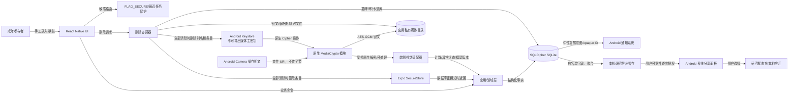

# 长期用药管理 APP｜隐私影响评估

> 本文评估离线 MVP 对参与者隐私的影响，不构成任何地区的法律合规结论。产品行为以离线 MVP 为最高基线。智能体草案不能替代隐私负责人、研究负责人、医学负责人或伦理审查机构的人类判断与签署。

## 0. 评估结论

当前设计通过单机离线、数据最小化、结构化数据加密、媒体独立加密、中性通知、敏感页截屏保护和主动研究导出，显著缩小了后台收集与远程泄露面；但它仍处理能揭示疾病、药物、规律和行为习惯的高度敏感信息。

在完成真机安全验证、人类签署和研究治理前，**不得招募真实患者**。以下为硬门禁：

1. SQLCipher、WAL/SHM、媒体密文、明文缓存、Keystore、自动备份排除和全部清除均有真机证据。
2. 媒体主密钥只在 Android Keystore 中生成和使用，保持不可导出；任何 JavaScript API、日志、数据库、文件或导出均不得取得其原文。
3. 研究包只能在字段白名单、预览、逐次授权之后通过系统分享离开设备；必须明确其为去标识/假名化资料，而非保证匿名。
4. 医学安全文案、知情同意、招募/排除、退出及研究方副本销毁流程已经审核。
5. 照片删除和全部清除只承诺移除应用可访问副本并销毁相关密钥，不承诺对闪存物理扇区进行法证级覆写。

## 1. 评估边界与方法

### 1.1 系统和参与者边界

- 对象：能独立确认用药的成年片剂/胶囊长期用药患者。
- 形态：无账号、无服务器、Android 先行的内部研究原型。
- 事实源：SQLCipher SQLite；照片位于应用内部私有目录的逐文件密文。
- 对外动作：只有用户主动调用系统分享面板的研究包导出；没有后台遥测、崩溃上报、推送或运行时更新。
- 不在本评估内：P1 加密备份、公开发布、iOS、云同步、在线问诊、大模型、照护者和第三方药物服务。

### 1.2 评估原则

- 目的限定：每个字段必须对应提醒、个人记录、库存、复诊、安全记录或已批准研究问题。
- 最少处理：不因“以后可能有用”采集额外身份或健康信息。
- 本地优先：能在本机完成的处理不离开设备。
- 选择与可见性：用户可看到照片用途、保留、导出字段和删除后果。
- 不夸大：加密、截屏保护、去标识和删除均按真实技术边界表述。
- 生命周期管理：收集、使用、展示、共享、保留、清除和退役均有责任人及证据。

风险分为高、中、低：高风险可能造成疾病或用药信息披露、错误关联、显著人身/社会影响，或当前控制尚未得到真机证明；中风险有实质影响但已有可验证控制；低风险影响和可识别性均有限。真实患者研究只允许不存在未接受的高风险项。

## 2. 数据流与信任边界



### 2.1 信任边界

| 边界 | 信任内 | 信任外或较低信任 | 主要控制 |
| --- | --- | --- | --- |
| 应用进程 | 已签名发布代码、原生模块、SQLCipher | 调试器、注入代码、被攻陷依赖 | release 禁止调试、依赖锁定、无动态代码、代码审查 |
| JavaScript/原生 | UI、领域命令 | 媒体主密钥与原始媒体加解密必须留在原生侧 | 窄接口、禁止 key/bytes 返回、桥接测试 |
| 应用沙箱/系统 | 私有数据库和密文 | 其他 App、备份服务、共享存储 | 私有目录、加密、FileProvider 最小授权、备份排除 |
| 屏幕/物理环境 | 已解锁敏感页面 | 旁观者、外拍摄像头、无障碍/投屏能力 | 应用锁、FLAG_SECURE、后台遮挡；外拍为残余风险 |
| App/研究生态 | 本机白名单导出 | 分享目标、研究人员、二次副本 | 预览、逐次同意、临时 URI、研究 SOP、接收后销毁责任 |

其中“其他 App”包括尝试读取通知、剪贴板、屏幕、分享 URI 或利用错误导出组件的普通恶意应用；应用沙箱和加密能降低其直接读取能力，但不能消除用户主动分享、无障碍授权或系统被攻陷后的风险。

## 3. 敏感数据清单与生命周期

### 3.1 内容和行为数据

| 数据 | 目的 | 本机位置与保护 | 默认保留 | 离开设备条件 | 删除方式 | 主要残余风险 |
| --- | --- | --- | --- | --- | --- | --- |
| 单患者档案、边界确认版本 | 初始化、证明用户看过边界 | SQLCipher | 使用期 | 不进入默认研究包 | 全部清除 | 本机身份可与药物信息关联 |
| 处方结构化字段、药名、规格、备注 | 按已有医嘱建立计划、回看 | SQLCipher；敏感页受保护 | 使用期；版本事实保留 | 默认不导出 | 全部清除；单条用版本/修订 | 疾病可由药名和组合推断 |
| 处方原图、包装和外观基准照片 | 回看和个人外观基准 | 应用私有 AES-GCM 密文；索引在 SQLCipher | 长期，或用户配置期限 | 默认不导出 | 删除密文及派生物，留墓碑；全部清除销毁密钥 | 图片可能含姓名、机构、处方号、背景环境 |
| 日常服药照片 | 视觉记忆凭证、端侧计数/异常提示 | 应用私有 AES-GCM 密文 | 长期，或用户配置期限 | 默认不导出 | 单张永久删除并留墓碑；全部清除 | 能推断药物、日程、家庭环境；明文相机缓存有短时暴露窗 |
| 计划、提醒窗口和时区快照 | 生成任务、分类晚服/漏服 | SQLCipher；通知仅接收中性文案与 opaque ID | 使用期及历史任务期 | 仅粗粒度研究指标可导出 | 全部清除 | 通知时间本身可暴露生活规律 |
| 逐药确认、实际数量、库存、修订 | 个人记录、库存与追溯 | SQLCipher；追加事实 | 使用期 | 默认研究包只导出结果类别/聚合 | 事实纠错用撤销/修订；全部清除 | 可反映健康行为和依从模式 |
| 漏服、副作用、疑似重复、症状和自由文本 | 个人记录及经审核的安全分流 | SQLCipher；自由文本不进研究包 | 使用期 | 默认不导出 | 全部清除；事实纠错保留修订链 | 自由文本可能含身份、地点和其他人的信息 |
| 复诊、取药、检查事项 | 本地提醒和摘要 | SQLCipher | 使用期 | 默认不导出 | 全部清除 | 日期与项目可推断疾病和医疗机构活动 |
| 视觉观察、模型版本、计数和异常状态 | 辅助核对、评测和追溯 | SQLCipher | 随关联记录 | 去标识结果类别可授权导出 | 清研究事件不删临床记录；全部清除 | 错误结果可引发焦虑；模型版本可链接稀有设备批次 |

### 3.2 安全、平台和研究数据

| 数据 | 目的 | 本机位置与保护 | 默认保留 | 离开设备条件 | 删除方式 | 主要残余风险 |
| --- | --- | --- | --- | --- | --- | --- |
| 数据库密钥 | 打开 SQLCipher | Expo SecureStore；打开时短时进入 JS/原生数据库边界 | 安装期 | 永不导出 | 全部清除/卸载删除 SecureStore 条目 | JS 垃圾回收不能证明即时擦除；进程被攻陷可盗用 |
| 媒体主密钥 | 封装/使用照片数据密钥 | Android Keystore，不可导出；只允许原生 Cipher 使用 | 安装期 | 永不离开 Keystore | 全部清除删除别名；卸载后失效 | 不保证所有设备硬件支持；被攻陷进程可能在本机调用密钥 |
| 每文件数据密钥、nonce、tag | 媒体认证加密 | 数据密钥只在原生内存短时存在并由媒体主密钥封装；封装值、nonce、tag 随密文/数据库保存 | 随照片 | 不导出 | 随照片内容删除；全部清除 | nonce 重用、内存转储或错误清理会破坏保护 |
| 通知 payload 和系统计划 | 打开相应任务 | Android 通知系统；仅 opaque ID 和中性文案 | 滚动窗口 | 系统组件可见 | 取消投影、卸载/全部清除 | 通知存在与时刻本身可形成推断 |
| 本地诊断日志 | 排查崩溃和平台故障 | 限额环形、只允许固定错误码/粗粒度指标；排除备份 | 短期滚动 | P0 默认不导出；后续诊断包需另行授权 | 用户清除诊断或全部清除 | 异常栈和文件路径可能意外带出敏感值 |
| 本地研究事件 | 回答研究问题 | SQLCipher；随机研究会话 ID、粗粒度时间和类别 | 至用户清除/退出 | 逐次授权研究包 | 清研究事件或全部清除 | 稀有事件组合仍可能重识别/链接 |
| 研究导出暂存包 | 交付去标识研究资料 | 应用内部 cache，字段清单和 SHA-256 受审计 | 分享完成/取消后立即清理，启动时清孤儿 | 预览、有效同意、用户选择接收应用 | 删除暂存；无法删除接收方副本 | 接收方可复制或上传；分享撤回不能召回副本 |
| 删除墓碑与审计事件 | 证明内容已删除和高风险操作发生 | SQLCipher；不含原图、密钥和自由文本 | 使用期 | 默认研究包仅允许聚合类别 | 全部清除 | 关联 ID 和时间仍可形成行为轨迹 |

### 3.3 明确禁止收集或输出

- 手机号、邮箱、广告 ID、稳定硬件标识、联系人和精确位置。
- 后台网络遥测、远程崩溃日志、远程配置和运行时下载记录。
- 研究包中的照片、处方原图、药名、疾病、处方/症状/备注自由文本和原始精确时间。
- 日志中的密钥、数据库口令、照片字节、药名、疾病、完整文件路径、表单内容和异常对象原文。
- 视觉模型生成的药名、真伪、剂量正确性、安全性或吞服结论。

## 4. 目的、必要性与比例性

| 处理活动 | 必要性判断 | 更少侵入的替代 | 当前选择 |
| --- | --- | --- | --- |
| 拍摄日常药物 | 核心研究假设需要视觉记忆线索 | 仅点击打卡、允许跳过拍照 | 默认整组一张、可逐药；始终允许说明原因跳过 |
| 保存处方/包装原图 | 帮助用户回看录入来源和外观基准 | 仅手工字段 | 原图可选/可删除，不做 OCR，不自动改写字段 |
| 长期保存照片 | 支持较长时间回看 | 定期自动删除 | 默认长期但允许期限和立即删除；研究同意需突出风险 |
| 本地视觉处理 | 提供计数和疑似变化提示 | 完全人工 | 模型可关闭，失败不阻断；原始图片不上传 |
| 逐药确认和库存 | 准确处理多药与部分服用 | 单一“已服用”按钮 | 逐药最小事实，避免错误整组推断 |
| 研究事件 | 验证可用性和回退 | 不采集研究指标 | 本机最小事件；主动导出，不后台上传 |
| 应用锁/截屏保护 | 防止旁观和偶然泄露 | 仅依赖设备锁 | 应用锁可选并主动引导；敏感页截屏保护默认开启 |

结论：在模型可关闭、拍照可跳过、研究导出逐次授权的前提下，处理与内部研究目标基本相称。但处方/照片默认长期保留是较高隐私负担，必须在真实参与者可用性与知情同意中单独验证，而不能埋在通用条款中。

## 5. 隐私控制要求

### 5.1 收集和输入

- 首次使用分别呈现产品边界与研究知情同意；产品操作同意不能替代研究同意。
- 表单只保留 MVP 必需字段；自由文本提示不要填写身份证号、地址、电话或其他人的信息。
- 处方/照片拍摄前提示移除无关身份材料和背景物；不请求相册、联系人或位置权限。
- 敏感自由文本输入禁用个性化学习、自动填充和不必要剪贴板功能；需真机验证键盘仍可能保存内容的残余风险。

### 5.2 本机存储与密钥

- SQLCipher 必须覆盖主数据库、WAL 和 SHM；数据库密钥只保存于 SecureStore，不写入源码、普通偏好、日志或诊断。
- 数据库密钥进入 JavaScript 是 ADR-004 的已知 P0 暴露面：只在启动解锁链路读取，禁止挂入 React/Zustand、错误对象或全局可序列化状态；使用后立即释放引用，但不得宣称 JS 内存已经可靠擦除。
- 媒体主密钥由原生模块通过 Android Keystore 生成，`getEncoded()` 不得返回有效字节；JavaScript 只能传 `assetId`、输入/输出文件描述符和操作参数，不能接收密钥、封装前数据密钥或解密后照片字节。
- 原生模块对每张照片生成独立 256-bit 数据密钥和唯一 96-bit GCM nonce；媒体主密钥仅封装数据密钥。文件头必须被纳入 AAD 或认证范围，篡改一律拒绝。
- 原生接口只返回随机资源 ID、结果码、密文大小和必要的非敏感元数据。密钥安全级别通过 `KeyInfo` 记录为软件、TEE 或 StrongBox 类别，但不得记录 key material。
- 硬件保护不可用不能自动改用硬编码/JS 密钥；安全负责人依据设备矩阵决定支持或标明降级。不可导出性是最低要求，硬件支持是单独的防护强度证据。

### 5.3 明文媒体和缓存

- 相机缓存 URI 视为明文敏感数据。原生模块流式读取、加密、原子落盘并确认后立即删除；失败和强杀由启动清理器处理。
- 不生成明文缩略图。敏感展示应优先使用原生受控解密视图；端侧推理应在原生侧解密和预处理，只把计数/状态等最小结果返回 JS。
- 如果所选 TFLite 适配器必须让明文照片或可逆像素缓冲进入 JS，ADR-005 的安全边界未满足，S03/S06 不得判定通过；需改造原生适配器或关闭视觉能力。
- 后台、锁屏、页面卸载和内存压力回调时清除解密视图和临时文件引用；不把解密 URI写入导航参数、Zustand 或持久化日志。

### 5.4 通知、屏幕和应用锁

- 通知标题/正文禁止药名、剂量、疾病、异常和服用结果；payload 只含不可读的 occurrence ID。
- 敏感路由默认启用 `FLAG_SECURE` 等价保护并隐藏最近任务预览；切路由、旋转和退后台不得出现泄露帧。
- 截屏保护不能阻止另一台摄像设备、被攻陷系统或部分无障碍/投屏通道，用户文案不得承诺绝对防截取。
- 应用锁只控制敏感页面和操作，不替代数据库/媒体加密。退后台、屏幕锁定和可配置短时超时后重新验证；认证失败不删数据、不创建新库。

### 5.5 备份、导出和第三方应用

- P0 `allowBackup=false`，同时为 Android 11 及以下和 Android 12+ 配置排除规则；数据库、WAL/SHM、媒体、SecureStore、研究、导出暂存和诊断均不得进入云备份或设备迁移。
- release-like 包应移除 Android `INTERNET` 权限；若构建工具强制保留，必须用抓包与依赖审计证明核心全流程零外联，并由安全负责人接受残余风险。
- 研究包使用严格字段白名单和版本化 manifest；拒绝未知字段，禁止“把整库导出后再清洗”。
- 导出采用应用私有临时文件与只读、短期 `content://` URI；FileProvider `exported=false`，只对用户选择的接收方临时授权，分享完成/取消后撤销权限并删除暂存。
- 系统分享后的副本不再受 App 控制。界面和同意书必须说明接收应用可能是云盘/聊天工具，研究方副本只能依研究 SOP 请求撤回或销毁，不能由 App 技术召回。

### 5.6 保留、删除和研究退出

- 用户可按单张照片、研究事件和全部本机数据三个粒度删除；保留期限改变仅影响未来自动清理，界面需显示预计清理范围。
- 单张照片删除采用 pending → 物理删除验证 → tombstone；删除失败不得显示成功或继续展示解密内容。
- 全部清除顺序：锁定新写入 → 删除媒体主密钥别名及 SecureStore 数据库密钥 → 删除数据库/WAL/SHM、媒体、缓存、导出和日志 → 验证路径不存在 → 回到未初始化状态。
- 对闪存只能承诺应用可访问副本删除与密钥销毁；不得承诺物理扇区覆写。已经分享、截图、系统/OEM 未遵循规则形成的副本不在应用单方面控制范围内。
- 研究退出必须区分：停止后续收集、本机清除、已交付研究副本的保留/销毁。具体选项、时限和例外由研究/伦理文件决定并签署。

## 6. 研究导出的重识别评估

### 6.1 默认字段白名单

允许候选字段仅限：导出 schema/manifest 版本、一次性包 ID、同意内容版本、事件类型、相对或粗粒度时间桶、耗时桶、结果类别、模型 manifest 版本、事件计数和包 SHA-256。原始精确时间、设备型号、地区、药物/疾病、照片、处方、自由文本和稳定硬件标识不得进入默认包。

### 6.2 风险与控制

| 重识别路径 | 风险 | 控制 | 残余风险 |
| --- | --- | --- | --- |
| 稀有事件序列或极小样本 | 高 | 时间分桶、类别合并、最小字段、导出前攻击测试 | 内部研究样本小，组合仍可能独特 |
| 多次导出可链接 | 中/高 | 每包随机 ID；是否保留纵向研究会话 ID须由研究方案明示和逐项签署 | 纵向研究若保留同一假名会形成长期画像 |
| 与研究招募表连接 | 高 | App 内不存招募身份映射；研究方分离保存、限权 | 研究人员仍可能凭时间/事件关联 |
| 用户选择非预期分享目标 | 高 | 目的地确认、明确警告、只读临时 URI | 接收方复制后无法召回 |
| 模型版本/设备性能组合 | 中 | 不默认导出具体设备型号；稀有版本聚合 | 小版本仍可暴露研究批次 |

“脱敏研究包”在产品文案中必须解释为减少直接身份信息的研究资料，而非保证匿名。真实研究前，隐私负责人需基于实际样本规模进行成员推断、唯一组合和外部数据连接测试，并决定是否进一步合并时间桶、抑制稀有类别或移除纵向 ID。

## 7. 隐私风险登记

| ID | 风险事件 | 初始 | 已有/要求控制 | 残余 | 处置 |
| --- | --- | --- | --- | --- | --- |
| P-01 | 设备丢失后处方和照片被查看 | 高 | 设备加密、SQLCipher、媒体 AES-GCM、可选应用锁、截屏保护 | 中 | 真机验证后由隐私负责人接受 |
| P-02 | 相机缓存或缩略图留下明文 | 高 | 原生流式加密、立即删除、无明文缩略图、启动清孤儿 | 中 | S03 硬门禁 |
| P-03 | 数据库密钥在 JS/日志暴露 | 高 | SecureStore、短生命周期、禁止序列化/日志、release 关闭调试 | 中 | ADR-004 安全签署 |
| P-04 | 媒体主密钥进入 JS 或可导出 | 高 | Keystore 不可导出、窄原生接口、静态/动态桥接测试 | 低/中 | 任一失败即 Gate B 失败 |
| P-05 | 系统备份或换机复制敏感数据 | 高 | allowBackup=false、双版本排除规则、真机恢复检查 | 低/中 | S07 硬门禁 |
| P-06 | 锁屏、截图、录屏或最近任务泄露 | 高 | 中性通知、FLAG_SECURE、后台遮挡 | 中 | S05；外拍残余需告知 |
| P-07 | 日志、异常栈或输入法缓存泄露 | 高 | 固定错误码、禁敏感日志、敏感输入配置、环形限额 | 中 | 静态/真机检查 |
| P-08 | 研究包组合重识别 | 高 | 白名单、分桶、预览、逐次同意、攻击测试 | 中/高 | 未签署前不得真实研究 |
| P-09 | 分享目标保存或转发副本 | 高 | 目的地提示、临时 URI、研究 SOP | 高 | 必须由参与者同意和研究治理接受 |
| P-10 | 删除承诺超过技术能力 | 高 | 准确文案、密钥销毁、路径验证、墓碑 | 中 | 隐私与 UX 签署 |
| P-11 | 恶意/被攻陷第三方依赖访问数据 | 高 | 最少依赖、锁版本、SBOM、无网络权限/外联、原生边界 | 中 | 依赖审计和发布门禁 |
| P-12 | 研究原型被非参与者长期使用 | 高 | 受控分发、研究标识、退出和设备回收/清除 SOP | 中 | 研究负责人签署 |

## 8. 参与者透明度与控制清单

真实研究材料至少要用通俗语言说明：

1. 照片帮助回忆，不证明吞服；端侧模型不判断药物、剂量或安全。
2. 处方和照片可能透露疾病，包括高度敏感的感染状态或治疗信息。
3. 数据默认只在本机；当前无账号恢复，卸载或密钥失效可能造成不可恢复的数据丢失。
4. 应用锁是可选的，截屏保护不是绝对防护。
5. 照片默认长期保存，可设置期限或立即删除；“永久删除”按应用可访问副本与密钥销毁的边界解释。
6. 研究数据不会后台上传；每次导出前可预览并授权，系统分享后 App 无法控制接收方副本。
7. 可停止参与、清除研究事件或清除全部本机数据；研究方已经收到的数据如何处理以研究同意书/SOP 为准。
8. 拒绝应用锁、拍照、视觉分析或研究导出不会改变已有医疗照护；其中拍照可说明原因后继续人工记录。

## 9. 验证与证据要求

| 验证项 | 方法 | 通过标准 | 证据 |
| --- | --- | --- | --- |
| 数据清单一致性 | schema、页面、权限、依赖和文件树审查 | 未发现清单外敏感字段/SDK/目录 | 字段 diff、权限清单、SBOM |
| SQLCipher 静态数据 | DB/WAL/SHM 哨兵扫描、错钥匙 | 无哨兵明文；错钥匙不能读且不清库 | S01 证据包 |
| 媒体主密钥边界 | 原生接口审查、`getEncoded()`、bridge 拦截、堆/日志扫描 | JS 接口永不返回 key/DEK/plain bytes；媒体主密钥不可导出 | S02/S03、代码审查记录 |
| 媒体生命周期 | 拍摄各阶段强杀、缓存/缩略图/孤儿扫描 | 成功后无明文；失败不显示保存；孤儿可清理 | S03 证据包 |
| 备份和迁移 | Android 11-/12+ 备份恢复、APK 规则审查 | 敏感哨兵恢复数为 0 | S07 证据包 |
| 屏幕和通知 | 截图/录屏/最近任务/通知监听场景 | 敏感页按设计阻断；锁屏无敏感内容 | S04/S05 录像 |
| 研究导出 | 白名单、未知字段、取消、错误目标、孤儿包 | 未授权不生成；无禁用字段；暂存可清理 | 包清单、测试报告 |
| 删除 | 单照、失败重试、全部清除、卸载 | 无应用可访问内容/缩略图/密钥；墓碑符合最小字段 | 路径/密钥前后清单 |
| 零外联 | release-like 全旅程抓包和权限扫描 | 无 DNS/TCP/HTTP；分享动作前无外部数据流 | S07 抓包摘要 |
| 文案理解 | 成人参与者认知访谈 | 能复述照片、模型、保留、导出和删除边界 | 已批准研究记录 |

## 10. 人类签署和复评触发器

### 10.1 真实患者研究前签署

| 角色 | 必须签署 |
| --- | --- |
| 隐私负责人 | 数据清单、目的、默认保留、导出白名单、重识别测试、删除和残余风险 |
| 安全负责人 | SQLCipher、密钥边界、媒体格式、备份排除、全部清除和真机证据 |
| 研究负责人/伦理审查 | 招募身份与 App 数据分离、同意、撤回、研究方副本保留和销毁 |
| 医学/药学负责人 | 高敏疾病/药物场景的风险说明及安全文案不会扩大医疗能力 |
| 产品/UX 负责人 | 应用锁、截屏、长期保留、分享后失控和删除边界能够被用户理解 |

### 10.2 必须重新评估的变化

- 增加账号、服务器、云同步、在线模型、远程日志、照护者或第三方 SDK。
- 改变研究字段白名单、时间粒度、会话 ID、保留期限或接收方。
- 支持新剂型、未成年人、无法独立确认者或正式公开发布。
- 更换数据库、SecureStore、媒体加密、TFLite、分享或截图依赖。
- 改变最低 Android 版本、自动备份策略、密钥安全级别或运行时更新策略。
- 发生数据泄露、误导性删除、异常重识别或研究方案重大修订。

## 11. 官方依据（访问日期：2026-08-23）

- [OWASP MASVS：移动应用安全验证标准](https://mas.owasp.org/MASVS/)
- [OWASP MASVS-PRIVACY-1：最小化敏感数据访问](https://mas.owasp.org/MASVS/controls/MASVS-PRIVACY-1/)
- [OWASP MASWE-0001：私有存储中的敏感数据加密](https://mas.owasp.org/MASWE/MASVS-STORAGE/MASWE-0001/)
- [OWASP MASWE-0006：敏感数据排除备份](https://mas.owasp.org/MASWE/MASVS-STORAGE/MASWE-0006/)
- [Android Keystore](https://developer.android.com/privacy-and-security/keystore)
- [Android KeyInfo：密钥安全级别](https://developer.android.com/reference/android/security/keystore/KeyInfo)
- [Android：应用专属文件](https://developer.android.com/training/data-storage/app-specific)
- [Android：安全文件分享](https://developer.android.com/training/secure-file-sharing)
- [Android：日志信息泄露](https://developer.android.com/privacy-and-security/risks/log-info-disclosure)
- [Android：备份安全建议](https://developer.android.com/privacy-and-security/risks/backup-best-practices)
- [Android：保护敏感 Activity 与 FLAG_SECURE](https://developer.android.com/security/fraud-prevention/activities)
- [Expo SecureStore](https://docs.expo.dev/versions/latest/sdk/securestore/)
- [NIST SP 800-38D：GCM/GMAC](https://csrc.nist.gov/pubs/sp/800/38/d/final)
- [NIST SP 800-122：PII 保密性保护指南](https://csrc.nist.gov/pubs/sp/800/122/final)
- [NIST Privacy Framework](https://www.nist.gov/privacy-framework)

## 统一交接摘要

```text
产出文件：
D:\help_u_surivive\medication-adherence-app\docs\security\隐私影响评估_v0.1.md

使用的基线版本：
四份基线（PRD v0.1、离线 MVP v0.1、总体架构 v0.2、治理审计 v0.1）；
第一波交互 v0.1、数据契约 v0.1、Phase 0 v0.1 和 ADR-001—015；均读取 2026-08-23 版本。

已冻结决策：
数据生命周期、目的限定、默认保留和删除边界；SQLCipher/SecureStore 与 Keystore 媒体密钥分层；
媒体主密钥/数据密钥/明文照片不得进入 JS；中性通知、敏感页保护、备份排除；
研究包字段白名单、逐次授权、临时 FileProvider 分享和重识别评估。

外部证据与访问日期：
OWASP MASVS/MASWE、NIST SP 800-38D/SP 800-122/Privacy Framework、Android 与 Expo 官方文档；2026-08-23。

发现的基线冲突：
无产品范围冲突。主智能体已将架构、ADR-010 和 Phase 0 统一为专用原生 `VisionInferenceModule`，并补入 bridge 负面接口测试；
解密、预处理和 LiteRT 推理必须留在原生侧，JS 只接收最小结构化结果。S02/S03/S06 仍需用代码审查和真机证据证明该边界；
若原生适配器无法满足，必须关闭视觉，不能放宽密钥或明文媒体边界。

需要人类签署的事项：
默认长期照片保留；数据库密钥短时进入 JS 的残余风险；低端机非硬件 Keystore 的支持策略；
研究包纵向 ID、时间分桶和重识别门槛；分享后副本撤回/销毁；删除承诺；全部真实患者文案。

自动检查结果：
待与威胁模型一并执行链接、围栏、敏感数据生命周期和越界检查。

残余风险：
被攻陷/Root 设备可在本机调用密钥；JS 数据库密钥不能证明即时擦除；FLAG_SECURE 不能阻止外拍；
闪存不能保证法证级覆写；系统分享后的副本无法技术召回；小样本研究事件组合仍可能重识别。
```
